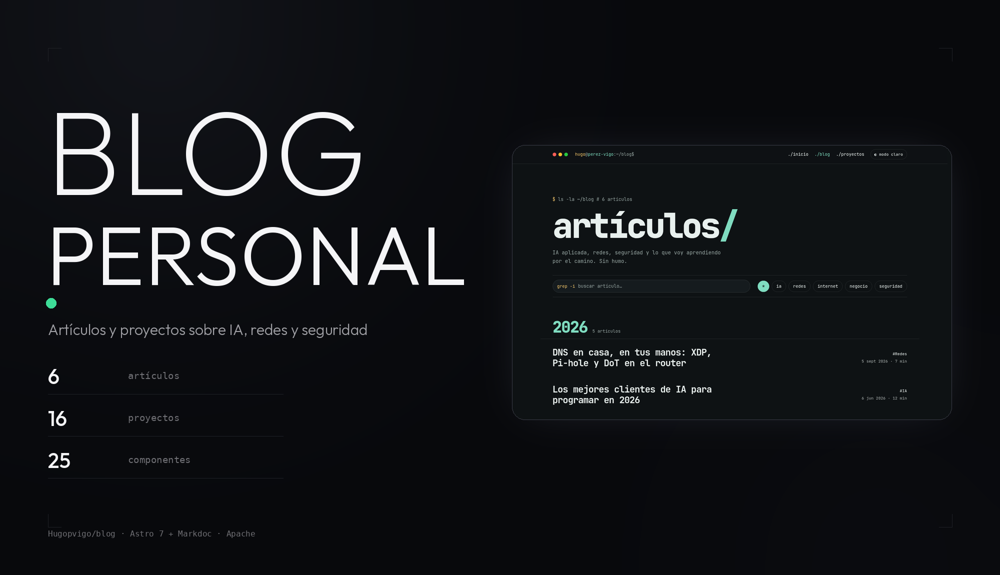
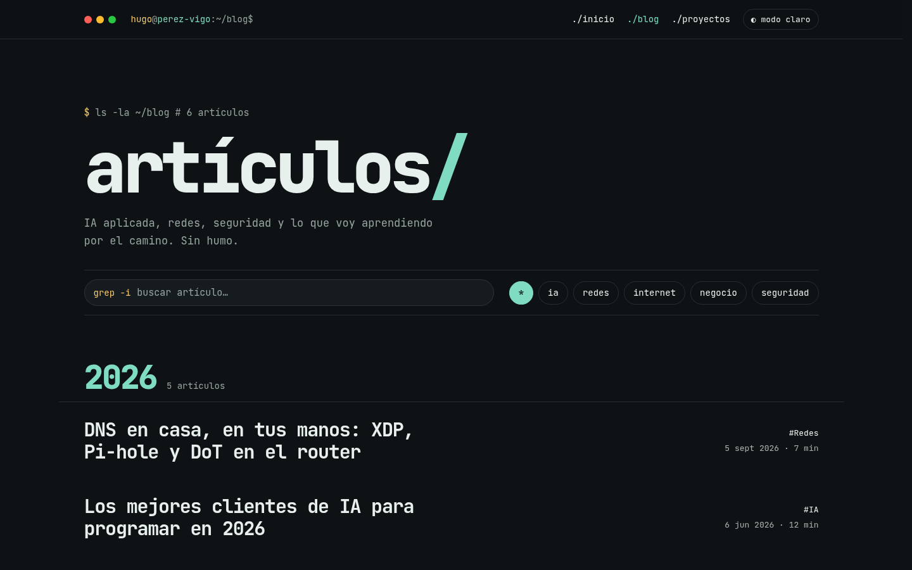

<p align="center">
  
</p>

<p align="center">
  <b>El blog y el portfolio de Hugo Pérez Vigo, con estética de terminal.</b><br>
  Artículos sobre IA, redes y seguridad, y la lista de los proyectos que hay detrás.
</p>

<p align="center">
  
  
  
  
  
</p>

---

## Qué es esto

Un sitio estático con dos secciones: **artículos** (6 publicados; en el repo hay
8 ficheros, 2 en borrador) y **proyectos** (16 fichas). Todo el diseño imita una
terminal: la cabecera es una ventana de terminal con los botones de la Mac, los
títulos van en monoespaciada y los filtros son pastillas que parecen comandos.

- **Oscuro por defecto**, con conmutador a claro. La preferencia se guarda en
  `localStorage` y se aplica antes del primer pintado.
- **Filtro por etiqueta y buscador** en la propia página, sin recargar: el
  script normaliza mayúsculas y diacríticos, así que `redes` encuentra
  «Redes».
- **Fragmento de código** en la cabecera de cada artículo: un `snippet` de
  3 a 5 líneas, ≤40 caracteres por línea, que es un guiño al tema del post.
- **Contenido en Markdoc**: etiquetas propias para YouTube, Tweet, CodePen,
  Gist, figuras, títulos con anclas y bloques de código con Prism.
- **SEO de serie**: `sitemap` automático, RSS en `/rss.xml`, canonical en cada
  página, Open Graph y Twitter Card, `robots.txt` y `site.webmanifest`.
- **Fuentes autoalojadas** (Fontsource): JetBrains Mono para la interfaz e
  IBM Plex Sans para el cuerpo, sin CDN de Google.


*La lista de artículos: el prompt `ls -la ~/blog`, el buscador y las pastillas
de etiqueta.*

## Escribir contenido

Los posts van en `src/content/blog/` y las fichas de proyecto en
`src/content/projects/`, en formato `.mdoc`. La plantilla está en
[`plantillas/post.mdoc`](plantillas/post.mdoc).

El `tag` es **obligatorio** en los posts publicados: si falta, el build falla.
Los valores permitidos están en `BLOG_TAGS` (`src/config.ts`); los tipos de
proyecto, en `PROJECT_TYPES`.

```mdoc
---
external: false
title: "Título del artículo"
description: "De qué va, en una línea."
date: 2026-01-01
tag: "IA"                    # obligatorio si el post no es draft
snippet:
  file: "mi-snippet.sh"
  lang: "bash"
  code: |
    $ comando --que-hace-cosa
---

El cuerpo va en Markdoc: **negrita**, `código` y
.
```

Los componentes que se pueden usar en el cuerpo:

| Etiqueta | Qué inserta |
|---|---|
| `youtube` | Vídeo de YouTube en un `iframe` con `sandbox` |
| `tweet` | Publicación de Twitter/X |
| `codepen` | Pen de CodePen |
| `gist` | Gist de GitHub, con el HTML saneado |
| `figure` | Figura con pie de foto |
| `heading` | Encabezado con anclas y tabla de contenidos |

## Desarrollo local

```bash
npm install
npm run dev       # servidor de desarrollo en http://localhost:3000
npm run build     # genera el sitio en dist/
npm run preview   # sirve el build
npm run clean     # borra dist/
```

## Despliegue

El sitio se compila **en el servidor** y lo publica Apache. `deploy.sh` hace
el ciclo completo:

```bash
bash deploy.sh              # compila y publica
bash deploy.sh --rollback   # vuelve a la generación anterior
```

El script instala dependencias (`npm ci`), compila (`npm run build`), guarda
la generación que está publicada en `dist.prev/` (y `dist.prev.prev/`),
sincroniza `dist/` con el `DocumentRoot` de Apache (`/var/www/html/dist`) con
`rsync --delete` y ajusta permisos. `--rollback` restaura la última
generación **distinta** de la publicada, para que repetir un deploy malo no
deje el rollback sin salida.

El dominio de producción es el que declara el propio repo en
[`astro.config.mjs`](astro.config.mjs) (`https://hugoperezvigo.es`); el 404 lo
genera Astro (`src/pages/404.astro`) y se registra con
`ErrorDocument 404 /404.html` en `public/.htaccess`.

## Cómo está hecho

```
blog/
├── plantillas/post.mdoc     plantilla de un artículo
├── docs/capturas/           capturas de la web
├── public/                  imágenes, iconos, robots.txt, .htaccess
├── src/
│   ├── assets/projects/     capturas de los proyectos
│   ├── components/          25 componentes .astro (ventanas, filtros, home…)
│   ├── content/             blog/ y projects/ en Markdoc
│   ├── layouts/             PageLayout, ContentLayout, tema, fuentes
│   ├── lib/                 SEO, normalización de texto, utilidades
│   ├── pages/               index, blog, blog/[slug], projects, rss, 404
│   ├── scripts/             filtros del navegador
│   └── styles/              tokens de la paleta
├── astro.config.mjs
├── markdoc.config.mjs
└── deploy.sh
```

Stack: **Astro 7** (SSG), **Markdoc 2** para el contenido, **Tailwind CSS 4**
mediante el plugin de Vite (sin fichero de configuración), **TypeScript 7** y
un plugin propio de Astro que mide con `sharp` las imágenes de `public/images/`
para poder reservar su hueco en el HTML.

## Licencia

El contenido y el código de este repositorio están bajo **CC BY-NC-SA 4.0**:
compartir con atribución, sin uso comercial y bajo la misma licencia. Consulta
[LICENSE](LICENSE) para el texto completo.
